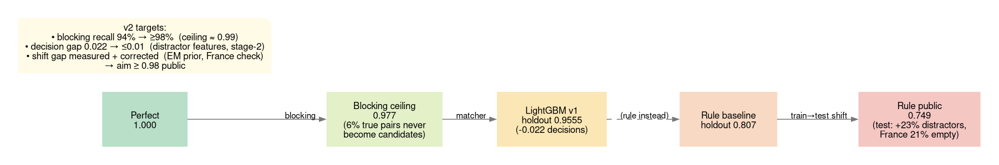
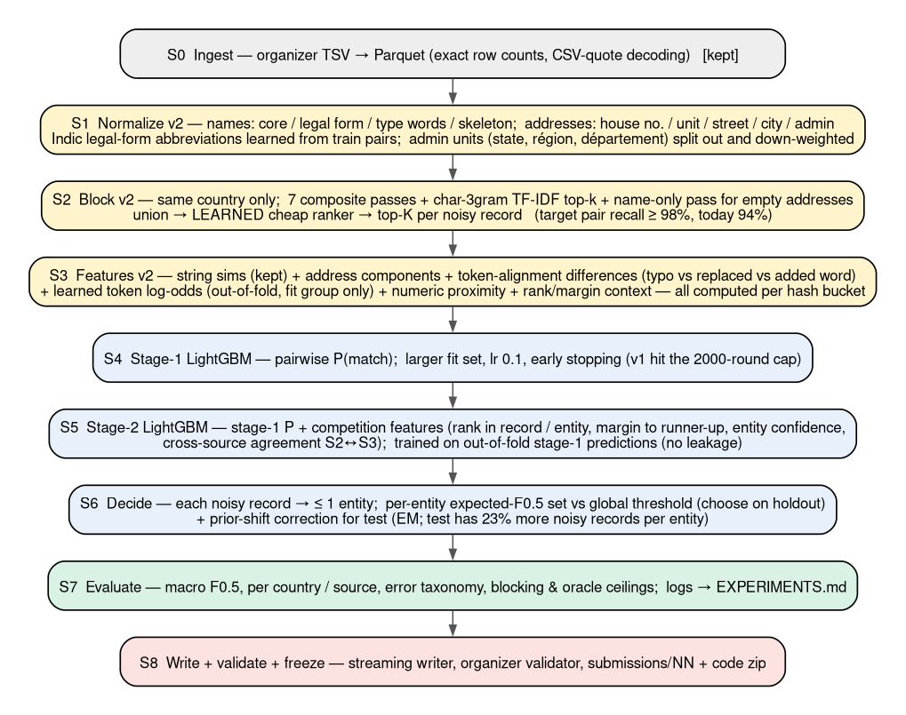
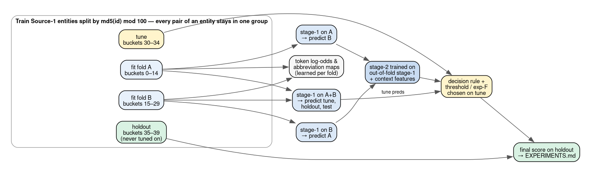

# Business Entity Resolution — Pipeline v2 Design

Status: **proposal, awaiting approval** · Written 25 Sep 2026 15:30 IST · Deadline 27 Sep 23:59 IST (~56 h left)
Every decision below has an ID (`D-0xx`) that is recorded in [`DECISIONS.md`](DECISIONS.md) with its reasoning,
alternatives, and evidence. Research notes behind this design:
[`research_notes/Business entity resolution methods/`](../research_notes/Business%20entity%20resolution%20methods/).

---

## 0. Where we are and what changes

| | Result | Source |
|---|---|---|
| Rule baseline (best candidate by hand-weighted score) | **0.749 public**, 0.807 local holdout | submission 01 |
| LightGBM v1 (45 string features, one model) | **0.9555 local holdout** (0.9563 tune) — not yet submitted (test features ran out of disk) | run `…063852_3b1b9a2_…_lgbm` |
| Perfect decisions on today's candidates | 0.977 — the ceiling set by blocking | forensics |
| Leaderboard leaders | ≈ 0.98 | user report |

**Verdict:** the architecture shape is right. Blocking → pairwise GBDT → constrained decision is what won the most
analogous public competition: a LightGBM-only Foursquare team reached 0.9935 IoU. So v2 is not a rewrite. It
**fixes four measured gaps**:

1. **Blocking recall** 94% → ≥98%. Today it caps us at 0.977.
2. **Near-duplicate distractors.** 26 k of 29 k false positives in the forensics are unmatched records that differ from
   a real business by one swapped or added word.
3. **Stage-2 reasoning.** The model decides each pair alone. It never asks "is this clearly better than the
   runner-up?" or "do the other sources agree?"
4. **Train → test shift.** Test has 23% more noisy records per entity in every country, and France (unseen, 15% of
   test) is under-matched.

---

## 1. Problem and data facts (all measured)

**Task:** for each Source-1 (clean reference) business, list every Source-2/3 record of the same business. The score is
F0.5 per Source-1 entity, macro-averaged. A singleton scores 1.0 only with an empty prediction.

| Fact | Value | Evidence |
|---|---|---|
| Size | train 2.21 M S1 / 10.32 M S2+S3; test 1.73 M / 9.97 M | `docs/data_profile.md` |
| Right-side exclusivity | each S2/S3 record matches **≤ 1** S1 (0 exceptions in 7.64 M pairs) | profile |
| Country | 100% of true pairs share a country | profile (200 k sample) |
| Singletons / multiplicity | 5.6% singletons; 3.46 matches per entity on average; 74% of S2/S3 records are matched | forensics |
| Name repetition | 50% of S1 names are shared with another entity; name + address unique (2,206,817 / 2,206,821) | forensics |
| **Test shift** | noisy records per S1: train 4.68 → test **5.8** (India 5.82, US 5.76, France 5.53) | forensics |
| Test mix | India 47%, US 38%, **France 15%** (train: US 60%, India 40%) | forensics |
| France under-matching | rule predicted no match for **20.6%** of French entities (India 5.3%, US 8.5%) | forensics |
| ID leakage | none: corr(S1 id, matched id) = 0.003 | forensics |

**What the noise looks like.** True matches carry *explainable* noise: typos, abbreviations, legal-suffix drift and
reordering, accents, junk prefixes, domain-style names, transliteration from 9 Indic scripts, truncated or empty
addresses, and reordered address components.

**Unmatched distractors** are built from a real record by making an *unexplainable* change:
- a swapped content word: "Bonanza **Real**" → "Bonanza **Travels**"
- an added business-type word: "… **Group**", "… **Ventures**", "… **Enterprises Company**"
- a nudged house number: 5124 → 5129

The whole redesign follows from this contrast.

**Rule-baseline error taxonomy** (holdout, 381 k true pairs):

| Outcome | Share |
|---|---|
| found | 73.3% |
| below threshold | 18.7% |
| **never a candidate** | 6.0% |
| lost to a rival entity | 2.1% |

Blocking misses are mostly Gujarati/Bengali/Hindi names whose address is truncated or empty. "प्रा. लि." ("Private
Limited") is not canonicalized. False positives: 26.5 k near-duplicate distractors, 2.7 k singletons, 0.3 k records
that belong to another entity.

---

## 2. What the research says

Full notes: `competitions_and_matchers.md` and `blocking_features_decision.md` in the research folder.

| Finding | Evidence | Consequence for us |
|---|---|---|
| Blocking → cheap GBDT top-K → richer GBDT / reranker → group post-processing is the universal winning shape | Kaggle Foursquare 2022 write-ups; the 7th place reached **0.9935 IoU with LightGBM only** | keep GBDT; add stage 2 (D-008) |
| Generic string features are weak on "dirty", near-duplicate data | Dirty Walmart-Amazon: Magellan GBDT 37.4 F1 vs Ditto 85.7 F1 | generic features are not enough; add **token-difference features** (D-013) |
| Learned token importance beats fixed similarity | importance-weighted Jaccard +5 F1; learned token weighting (HierGAT) up to +8.7 F1 over Ditto | **learn token log-odds from train pairs** (D-013) |
| TF-IDF / BM25 top-k is a strong blocker | Sparkly (VLDB 2023): 86–99.96% recall at top-10, beating deep blockers | add a char-3-gram TF-IDF pass (D-006) |
| Recall gaps are usually a **key-coverage** problem, not a cap-size problem | 150 M-record company matcher | add new passes for the missed patterns rather than raising K |
| Score, then prune, the unioned candidates (meta-blocking) | Papadakis et al. / JedAI | replace the hand-weighted cut with a **learned** cheap ranker (D-006) |
| "Predict nothing when unsure" is F-optimal; exact set selection exists | Jansche 2007; Dembczyński (GFM, O(m²)) | per-entity expected-F0.5 decision, compared with a threshold (D-009) |
| Standard fix when test has a different positive rate | Saerens-Latinne-Decaestecker EM (2002); BBSE (2018) | prior-shift correction on test (D-010) |
| Global bipartite optimization can *hurt* precision in ER | greedy-vs-Hungarian ER study | keep best-per-record, not Hungarian (D-003) |
| Small fine-tuned LMs come close to GPT-4 | AnyMatch: within 4.4 F1 of GPT-4 | possible stage-3 reranker, **deferred**: CPU speed unproven and pretrained models not yet confirmed by organizers (D-014) |
| Licenses | LightGBM MIT; multilingual-e5-small MIT; paraphrase-multilingual-MiniLM Apache-2.0; bge-m3 MIT; mDeBERTa MIT | all fit the ≤8B MIT/Apache rule if ever used |
| French addresses = street + postal code + commune; région is not part of the address | French postal standard | treat admin units as low-weight; no département↔région map (D-011) |

---

## 3. Architecture

Engineering rule for every stage (D-019): **nothing runs a global window, sort, or aggregate over more than ~10 M rows
at once.** Stages process hash buckets of an id. Big inputs are Parquet views streamed from disk, never in-memory
tables. This follows from 5 incidents: the quadratic join, the 60 GB spill, two out-of-memory crashes in the writer,
and the 30 GB spill in test features (see §8).

### S0 — Ingest (kept)

- **What:** convert the 7 TSVs to zstd Parquet and verify exact row counts. Decode CSV quoting, as the organizer's pandas
  example does.
- **Output:** `raw_{split}_s{n}.parquet`, `train_gt_pairs.parquet`.
- **Why:** it's done and proven (60 s, 664 MB). DuckDB streams from disk, so 24 M records fit on a 15 GB laptop (D-001).

### S1 — Normalize v2

**What changes and why:**

| Change | How | Why (evidence) |
|---|---|---|
| **Name decomposition** into `name_core` (content words), `legal_form` (canonical Pvt Ltd / LLP / Inc / SARL…), `type_words` (Group, Services, Ventures…), and `name_skel` | extend the current maps; the type-word list is **learned**: tokens whose presence on only one side is much more frequent in negative pairs | distractors add or swap exactly these words; features must see them separately (D-013) |
| **Indic legal-form abbreviations** ("प्रा. लि." → "pra li" → "private limited") | a map **learned from train pairs**: align transliterated tokens to the Source-1 tokens of the same entity, keep high-confidence mappings (D-012) | these names dominate blocking misses; rules allow data-derived maps |
| **Address decomposition** into `house_nos`, `unit` (Unit/Suite/Flat/Shop/PMB/PO Box), `street`, `city`, `admin` (state/région/département) | comma-split + token classes. The `admin` vocabulary is learned as short non-numeric trailing components that recur across many records (train+test addresses, no labels) | lets features compare street + number + city while down-weighting the admin unit that differs for France (D-011) |
| Keep: anyascii transliteration, accent folding, junk stripping, alias/dba handling | measured best: 75.4 token-set ratio vs 67–74 for alternatives (D-016) | — |

### S2 — Block v2

**Target:** pair recall ≥ 98% at ≤ 10 candidates per noisy record. Today: 94% at 5.

| Pass | Catches | Status |
|---|---|---|
| 6 sorted-neighbourhood passes on composite name + address keys (window ±3) | typos, word order, repetitive names with the same address | kept (92.8% union recall on sample) |
| IDF token pass over name + address tokens | reordered components | kept |
| **char-3-gram TF-IDF top-k** over `name_core + street + city`, per country, chunked sparse top-k (sparse_dot_topn, Apache-2.0) | transliterated names, heavy typos, whole-word variants | **new** (Sparkly evidence) |
| **name-only pass** (skeleton + char-gram top-k) for noisy records whose address is empty or 1 component | the "empty address" misses | **new** |
| **learned cheap ranker** (small LightGBM on the ~6 blocking similarities + pass flags, trained on fit-group candidates) → top-K per noisy record | replaces the hand-weighted `block_score`, which kept 95.2% of the 95.6% available | **new** (meta-blocking) |

**Choosing K:** plot recall@K from the learned ranker on the tune group and take the smallest K within 0.2 points of
the plateau. The organizers audit `candidate_pairs.tsv`, and a smaller K also means fewer pairs to featurize (D-006).

### S3 — Features v2

v1 feature families are kept. New families, each aimed at a measured error:

| Family | Examples | Aimed at |
|---|---|---|
| **Token alignment** | align name tokens greedily by JW; count tokens on each side that are *exact / typo (edit ≤ 2 relative) / abbreviation / transliteration-equal (same skeleton) / legal form / unexplained*; IDF mass of unexplained tokens | distractors: one unexplained word vs explainable noise |
| **Learned token log-odds** | for each unaligned token: log P(neg)/P(pos), estimated **out-of-fold** on the fit group; sum / max / min per pair | "Group", "Ventures", "Travels" as distractor signatures |
| **Address components** | house-number relation (equal / digit-drop / one-digit change / far) and relative numeric distance; street similarity; city equality; admin equality (low weight); unit present on one side | nudged numbers vs truncated numbers; France admin mismatch |
| **Context (group)** | rank and margin of this pair among the noisy record's candidates and among the entity's candidates; candidate counts | "clearly the best?" |
| Kept from v1 | JW / ratio / token-set / partial on name, core, skeleton, address; Jaccard; lengths; scripts; source | — |

**Leakage rules for features** (D-004):
- Learned statistics (token log-odds, abbreviation maps, the type-word list) come **only from fit-group pairs**, computed
  out-of-fold for the fit group itself.
- No feature uses a label, an id's numeric value, or file row order.

### S4 — Stage-1 LightGBM

- **Training data:** fit group grows from 10% to 30% of train entities (buckets 0–29). Learning curve: compare 10% vs
  30% on the holdout and keep the gain only if it's real.
- **Settings:** learning rate 0.1, up to 5 000 rounds with early stopping on the tune group. v1 hit the 2 000-round
  cap while still improving.
- **Output:** out-of-fold predictions for the fit group (2 folds, A = buckets 0–14, B = 15–29), plus a full-fit model
  for tune / holdout / test.
- **Why LightGBM (D-007):** 0.9555 already; the Foursquare evidence; CPU-only; MIT license; fast.

### S5 — Stage-2 LightGBM (stacking)

- **Inputs:** stage-1 probability, plus features computed *from* stage-1 probabilities over the full candidate
  neighbourhood:
  - rank and margin within the noisy record's candidates
  - rank within the entity's candidates
  - the entity's number of confident candidates per source
  - **cross-source agreement:** max similarity between this noisy record and the entity's most confident candidate
    from the *other* source

  Built already on branch `worktree-agent-a9cd4f3beb2bc95cc` (17 features, simulations +0.4–1.6 points).
- **Leakage:** trained only on out-of-fold stage-1 predictions (§6 diagram). "Rival context" includes all candidates of
  any noisy record that touches the group, so the one-to-one step sees real rivals. This fixes a v1 blind spot.

### S6 — Decision

1. **One-to-one on the right side** (D-003): each noisy record keeps only its best entity.
2. Choose, **on the tune group only**, between (a) a global probability threshold and (b) per-entity expected-F0.5
   set selection with isotonic-calibrated probabilities (D-009). The empty set is scored with P(no true match).
3. **Prior-shift correction for test** (D-010): estimate the test match rate among candidates with Saerens EM on test
   predictions, rescale the probabilities, then apply the chosen rule. Sanity check: the predicted match rate per
   country should look like train's (about 3.4 per entity); France is flagged if it deviates.

### S7 — Evaluate (every run)

- Holdout macro F0.5 (headline), plus precision, recall, and singleton accuracy.
- Per country and per source.
- Blocking recall@K and the oracle ceilings.
- The error taxonomy (the forensics script becomes a `ber analyze` stage) with ~20 examples per error type.

Everything is written to the run's `manifest.json` and one line in `docs/EXPERIMENTS.md` (D-020).

### S8 — Write, validate, freeze (kept, hardened)

- Streaming writer (sorted pairs → TSV, no in-memory aggregation).
- Organizer validator with `--check-ids`.
- `submissions/NN_<time>/` gets the TSVs, a code zip of the exact commit, and notes; one row goes in the log.

---

## 4. Data splitting and formatting — the reasoning in one place

- **Split by Source-1 entity, not by pair** (D-004). All candidate pairs of one entity share strings and group
  features. A pair-level split would put near-copies of the same decision in train and validation and inflate the
  score.
- **md5(entity id) buckets:** deterministic on every machine, independent of file order, and new groups can be carved
  out without reshuffling.
- **Layout v2:**
  - fit A = 0–14, fit B = 15–29 (the two stacking folds)
  - tune = 30–34 (early stopping, threshold / decision rule)
  - **holdout = 35–39** (touched once per experiment, never tuned on)
  - 40–99 unused (spare)

  v1 will be re-scored on the new holdout so every comparison is like-for-like.
- **Features are computed for the fit/tune/holdout entities plus their rival context**, not for all 51 M train pairs.
  That's about 45% of the train pairs, which fits laptop memory when processed in buckets.
- **Formats:**
  - every table is Parquet with fixed column order
  - feature sets carry a version (`v2`) stored in each model's manifest; inference refuses a mismatch
  - models are saved as LightGBM text, not pickle
- **Why not pure K-fold cross-validation:** at 2.2 M entities, a 5% holdout is 110 k entities, which gives a standard
  error of about ±0.0006 on macro F0.5. K-fold would multiply compute for no decision-relevant precision.

---

## 5. How we make decisions and log them (your request)

- **`docs/DECISIONS.md`:** every design choice as a numbered record: *decision, why, alternatives rejected, evidence,
  status*. Append-only. A reversal gets a new record that points to the old one.
- **Every run's `manifest.json`** records the git commit, the full config, the decision IDs in effect, data
  fingerprints, per-stage row counts / times / peak memory, all metrics, and the chosen threshold / decision rule.
- **`docs/EXPERIMENTS.md`:** one row per run. Changes, holdout F0.5, per-country F0.5, blocking recall, and the delta
  vs the previous best. A change is kept only if its holdout gain beats noise, about 0.002.
- **The pipeline logs *why* a stage filtered something,** not just counts. Examples: "cap K=8 chosen at recall@8 =
  98.4%"; "threshold 0.71 chosen on tune (F0.5 0.962)"; "EM prior 0.58 vs train 0.74".

---

## 6. Execution plan (laptop, with measured speeds)

Fast loop first (D-018): each idea is tested on a 2% noisy-record sample for blocking, or on the tune/holdout groups
for modelling, in minutes. Only winners get a full run.

| Phase | Work | Expected gain | Time |
|---|---|---|---|
| **P0** | Bucket the test feature step (the 30 GB spill), predict test with the existing v1 model, EM prior check, **submit v1** | public ≈ 0.90–0.93; measures the shift gap | ~1.5 h |
| P1 | Normalize v2 (Indic legal forms, name/address components) + Block v2 (TF-IDF pass, name-only pass, learned ranker, K choice) | ceiling 0.977 → ~0.99 | ~4 h |
| P2 | Features v2 (token alignment, learned log-odds, address components) + stage-1 at 30%, lr 0.1 | decision gap 0.022 → ~0.01 | ~4 h |
| P3 | Merge stage-2 branch + rival context + decision comparison + prior correction; **submit** | +0.003–0.015 | ~3 h |
| P4 | Error-analysis rounds, France check, LightGBM seed ensemble; submissions as holdout improves | +0.002–0.005 | day 3 |
| P5 | Lock by ~20:00 on 27 Sep; `make reproduce`; methodology doc; final zip | — | ~3 h |

**Upload budget:** today 2 (v1 model, v2 if ready) · tomorrow ≤ 4 · 27 Sep ≤ 3, keeping one in reserve.

---

## 7. What we are deliberately *not* doing

| Not doing | Why |
|---|---|
| Transformer cross-encoder / LLM reranker (for now) | CPU throughput for 1–3 M pairs is unproven (no primary benchmark; a pilot is needed); organizers haven't confirmed pretrained models; LightGBM-only reached 0.9935 in the closest competition. Revisit only if P2 plateaus below 0.975 **and** a 50 k-pair timing pilot fits (D-014). |
| libpostal / geocoders / gazetteers | trained on external data (OpenStreetMap), so a disqualification risk (D-015) |
| Hand-written French département ↔ région map | legal gray zone and unnecessary: admin units are down-weighted instead (D-011) |
| Hungarian / global bipartite assignment | the right side is exclusive, but entities take many records; research shows global optimization can hurt ER precision (D-003) |
| Paid AWS compute | account is on the Free plan; large instances need a Paid-plan upgrade, which you declined |

---

## 8. Incidents so far and the rule each produced

| Incident | Root cause | Rule now |
|---|---|---|
| Blocking recall 46% | name-only keys on highly repetitive names | composite name + address keys (D-005) |
| Pass took >10 min on a 10% sample, never finished | expression inside a join key → quadratic join | materialize join keys as columns |
| 60 GB spill filled the disk | single-shot union of 400 M rows | bucket by id (D-019) |
| Writer out of memory ×2 | in-memory tables + ordered `string_agg` | stream sorted pairs from views |
| Test features: 30 GB spill | global window functions over 50 M pairs | P0 fix: per-bucket group features |
| Two agent batches cut off | usage limits | fewer agents, Sonnet for small work, notes saved incrementally |
