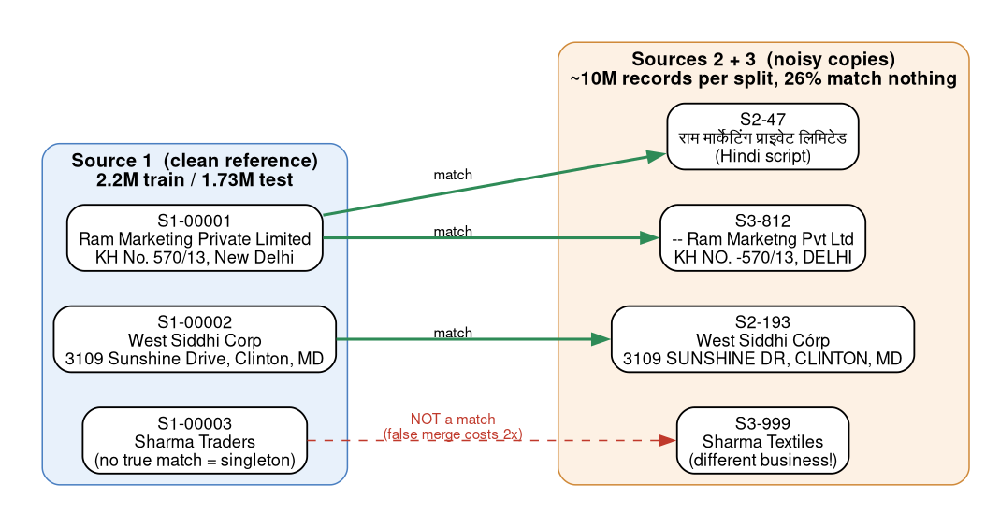
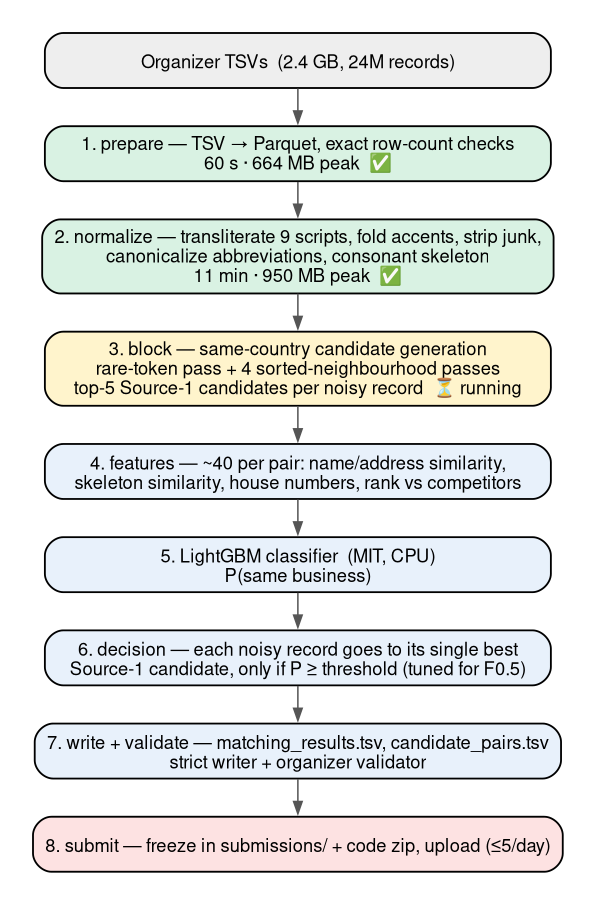
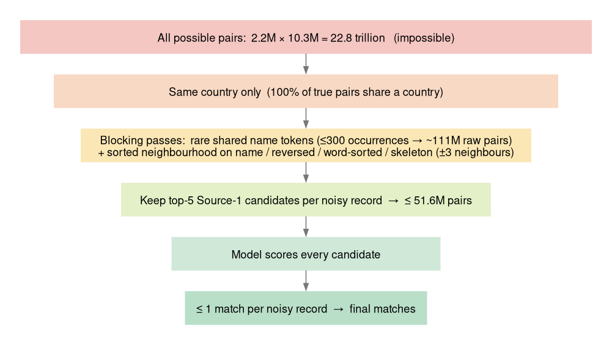
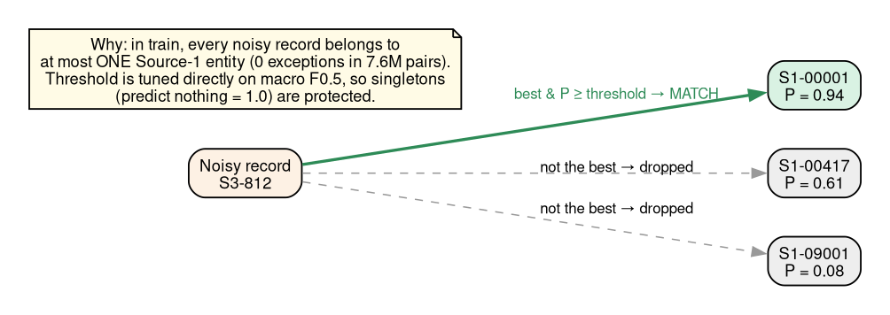
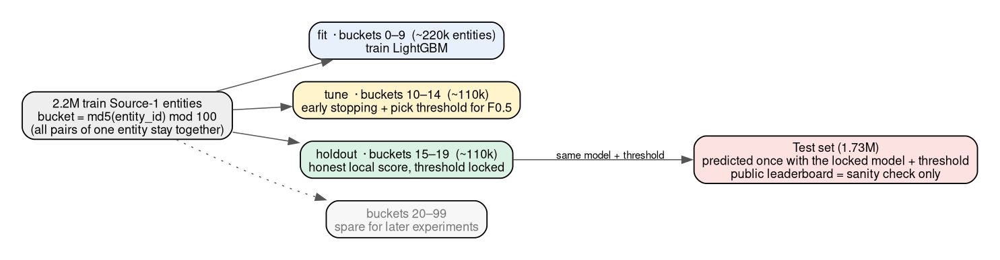
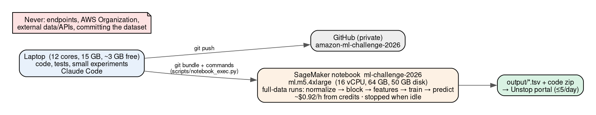

# Amazon ML Challenge 2026 — Project Plan

> **Superseded by [DESIGN_V2.md](DESIGN_V2.md)** (25 Sep 15:30) — v1 kept for history. Decisions: [DECISIONS.md](DECISIONS.md).

Deadline: **27 Sep 2026, 23:59 IST**. Leaderboard uploads: max 5 per day, each = `matching_results.tsv` + code zip.
Status legend: ✅ done · ⏳ in progress · ⬜ not started.

---

## 1. The problem



- **Source 1** is a clean list of businesses. **Sources 2 and 3** are noisy copies of (some of) them.
- For every Source 1 business, list every Source 2 / Source 3 record that is the same real business — zero, one, or many.
- **Score = macro F0.5 per Source 1 business.** Precision counts 2× recall. A business with no true match scores 1.0 if we
  predict nothing and 0.0 if we predict anything — wrong merges are the most expensive mistake.
- **Rules:** no external data or lookups of any kind; final model MIT/Apache-2.0 and ≤ 8B parameters; the test set adds
  France (not in train), so nothing may be hard-coded to US/India.

## 2. What the data told us (measured)

| Fact | Consequence |
|---|---|
| Train: 2.2M Source 1, 10.3M Source 2+3. Test: 1.73M and 9.97M. | Never compare all pairs (22.8 trillion). |
| Every noisy record belongs to **at most one** Source 1 business (0 exceptions in 7.6M true pairs). | Attach each noisy record to its single best candidate — big precision win. |
| Every true pair is in the **same country**. | Only compare records within a country. |
| 5.6% of businesses have no match; the rest average ~3.7 matches. 26% of noisy records match nothing. | Recall matters, but the threshold must still protect singletons. |
| Only 10.7% of true pairs have identical names. Noise: 9 Indian scripts, accents, junk prefixes, suffix shuffles, typos, aliases ("dba"), state abbreviations, changed house numbers. | Strong normalization before comparing. |
| Postal codes are almost absent (0–0.2%). | Postal code is weak evidence, not a blocking key. |

Details: `docs/data_profile.md`, `docs/normalization_findings.md`.

## 3. The pipeline



Each stage is one `ber` command that reads and writes files, so any stage can be re-run on its own.

## 4. Blocking — finding candidates without comparing everything



- **Rare-token pass:** records sharing an uncommon name word (words appearing ≤ 300 times are used; measured volume
  ~111M raw pairs on train — a cap of 1000 would be 306M, 3000 would be 1.6B).
- **Sorted-neighbourhood passes:** sort Source 1 and noisy records together by a key and pair each noisy record with its
  nearest Source 1 neighbours. Four keys catch different noise: plain name (suffix typos), reversed name (prefix typos),
  word-sorted name (word order), consonant skeleton (transliteration: "drim pavr" = "dream power" → `drm pvr`).
- **Cap:** keep the best 5 Source 1 candidates per noisy record → at most 5 × 10.3M pairs.
- We measure **recall** (share of true pairs that survive blocking) per pass — it is the ceiling on our score.

## 5. The decision rule



## 6. Validation — honest local scores



The public leaderboard is only a sanity check; all tuning happens on the train groups above.

## 7. Where things run



- Code is written and unit-tested on the laptop and pushed to the private GitHub repo.
- Full-data runs are planned for the SageMaker notebook on a larger instance (~$0.92/h from the team's credits for
  ml.m5.4xlarge), stopped whenever idle. **Blocked for now:** the account's quota for large notebook instances is 0 —
  see section 10.

## 8. Phases and status

| # | Phase | Status | Output |
|---|---|---|---|
| 0 | Understand rules + profile data | ✅ | `docs/hackathon_notes.md`, `docs/data_profile.md` |
| 1 | Foundation: config, TSV→Parquet, metric, strict writer, CLI | ✅ | `ber prepare / score / validate-output` |
| 2 | Normalization (9 scripts, skeleton key) | ✅ | `ber normalize` — 11 min for all 24M records |
| 3 | Blocking + recall measurement | ⏳ | `ber block`, recall per pass |
| 4 | Pair features | ✅ code / ⬜ full run | `ber features` |
| 5 | LightGBM + threshold tuning + holdout score | ✅ code / ⬜ full run | `ber train` |
| 6 | First test prediction + validator + **submission #1** | ⬜ | `ber predict`, `submissions/01_*` |
| 7 | Error analysis → improve blocking / normalization / features | ⬜ | wrong merges, missed matches, blocking misses |
| 8 | Reproducibility: one command end-to-end, pinned deps, README | ⬜ | `make reproduce` |
| 9 | Methodology document + final zip | ⬜ | `Documentation_template.md`, `<team>_submission.zip` |

Tests: 126 passing (normalization, blocking, features, decision, metric incl. the organizer's 0.714 example, writer
passing the official validator).

## 9. Submission plan (15 uploads total)

- **Day 1 (25 Sep):** 1–2 uploads — first full model, then the best quick fix.
- **Day 2 (26 Sep):** up to 4 — only when the holdout F0.5 improves.
- **Day 3 (27 Sep):** up to 3, keeping one in reserve for the final locked model before 23:59 IST.
- Every upload is frozen in `submissions/NN_<time>/` with its exact TSVs, code zip, and notes, and logged in
  `submissions/log.md`.

## 10. Risks

| Risk | Mitigation |
|---|---|
| AWS quota for large notebook instances is 0 | find an allowed instance type / request a quota increase; laptop remains the fallback |
| France behaves differently (unseen country) | language-agnostic normalization; check test prediction rates per country before uploading |
| Chain stores / same-name branches → wrong merges | address similarity, house-number agreement, name-frequency feature, one-match-per-record rule |
| Blocking misses true pairs | several complementary passes; recall measured per pass; error analysis on misses |
| Test has ~23% more noisy records per business than train | watch predicted match rates on test; keep the threshold precision-leaning |
| Laptop memory (crashed once) | memory limits + one heavy job at a time (shared lock) |

## 11. Commands (end state)

```bash
ber prepare                       # TSV → Parquet (row counts verified)
ber normalize --split train       # and --split test
ber block     --split train       # and --split test; prints recall on train
ber features  --split train       # and --split test
ber train                         # fit / tune threshold / score holdout → artifacts/runs/<run>
ber predict   --run artifacts/runs/<run>
ber validate-output               # organizer validator must print PASS
```
